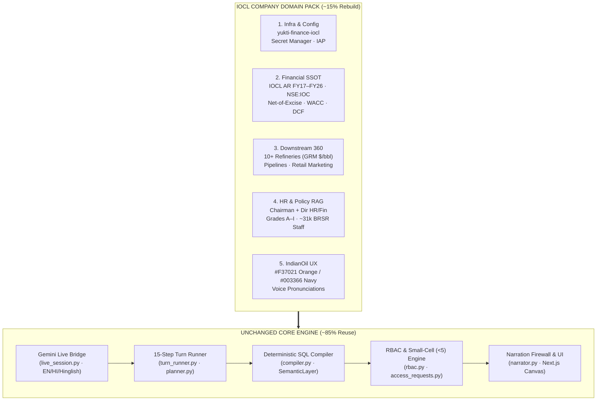

# Yukti IOCL — High-Level Platform Adaptation Plan

> **BLUF:** Roughly **85% of Yukti's core runtime engine** (Gemini Live voice bridge, 15-step deterministic turn runner, QuerySpec → BigQuery SQL compiler, pre/post-query RBAC + `<5` small-cell suppression, `allowed_numbers` narration firewall, access-request workflow, exports, and Next.js single-origin UI) **carries over unchanged**. Adapting Yukti for **Indian Oil Corporation Limited (IOCL)** requires isolating GCP/GitHub infrastructure and replacing the **15% company domain pack**—shifting from ONGC's **Upstream E&P** model (fields, wells, MMBOE, lifting cost, `E1–E9`, `CMD`) to IOCL's **Downstream Refining, Pipelines, Marketing & Petrochemicals** model (refineries, GRM $/bbl, throughput MMT, retail outlets, `Grade A–I`, `Chairman`).

---

## 1. Non-Negotiable Isolation Guardrails (Protecting the ONGC CMD Demo)

Before modifying any code or running any cloud command inside `Yukti IOCL`, enforce four hard boundaries so the live ONGC CMD demo (`ongc-hr-finance-agent` / `yukti-ai-v3p16-5e4ffd5`) can never be touched:

1. **Zero Git Link to ONGC (Completed):** `Yukti IOCL` was cloned with `--no-hardlinks` onto branch `iocl/init`, and `origin` was removed (`git remote -v` is empty). Connect it **only** to the dedicated IOCL GitHub repository (`https://github.com/amandeepsinghs-cyber/iocl-finance-agent.git`).
2. **Dedicated GCP Project & Named `gcloud` Profile:** Target GCP project **`yukti-finance-iocl`** (`asia-south1`) and run IOCL commands exclusively under `gcloud config configurations activate iocl` (while keeping `ongc` pinned separately).
3. **Separate Local Ports:** Run IOCL local dev servers on **`:3400`** (frontend proxy) and **`:8195`** (FastAPI backend) so they never collide with ONGC's `:3300` / `:8095`.
4. **Keep Dataset Base Names (`hrfin_*`), Swap Project ID:** Keep canonical BigQuery dataset names (`hrfin_bronze_v3`, `hrfin_silver_v3`, `hrfin_gold_v3`, `hrfin_ref_v3`, `hrfin_docs`) inside the new `yukti-finance-iocl` GCP project. That immediately eliminates churn across **351 files** referencing `hrfin_*` while preserving 100% physical project isolation.

---

## 2. Codebase Footprint & Engine vs. Domain Split

An audit of the 4,002 tracked files at baseline commit `5e4ffd5` shows where ONGC specifics live:

| Coupling Vector | Tracked Files Affected | Strategy for `Yukti IOCL` |
|---|---:|---|
| Hardcoded GCP Project (`ongc-hr-finance-agent`) | **192** | Replace with `YUKTI_GCP_PROJECT` / `yukti-finance-iocl` across `config.py`, `start_cloudrun.sh`, SQL views, and `load_bq.py` |
| Company Name & Copy (`ONGC`, Deendayal Urja Bhawan) | **400** | Update prompts, persona labels, UI chrome, templates, and eval fixtures to IndianOil / IOCL |
| Dataset Prefix (`hrfin_`) | **351** | **Keep unchanged** inside the new `yukti-finance-iocl` project (zero refactor cost) |
| Upstream / Policy Specifics (`WC-DEL`, `JRTP`, BOE, fields) | **303** | Replace with IOCL locations, Transfer Policy, Grades (`A–I`), and Refinery/Marketing/Pipeline KPIs |

### Architecture Split: What Stays vs. What Changes

---

## 3. Domain Translation Matrix: ONGC (Upstream) → IOCL (Downstream OMC)

| Dimension | ONGC Baseline (`HR and Finance_ONGC`) | IOCL Target (`Yukti IOCL`) | Key Code / Config Impact |
|---|---|---|---|
| **Apex Persona** | `CMD` — Chairman & CEO | **`CHAIRMAN`** (or `CMD` alias mapped to **Chairman, IndianOil** — IOCL's head is designated *Chairman*, not CMD) | `rbac_policy.yaml`, `app_users.yaml`, `personas.ts`, `access_requests.py` |
| **Board Personas** | `DIR_HR`, `DIR_FIN` | `DIR_HR`, `DIR_FIN` (+ optional `DIR_REF` Refineries, `DIR_MKT` Marketing) | Keep 11-persona RBAC structure for instant parity; swap names & designations |
| **Officer Grades** | `E1` – `E9` (`grade_id LIKE 'E%'`) | **IOCL Officer Grades `A, A1, B, C, D, E, F, G, H, I`** *(or mapped `A`→`E1` display labels; Note: `grade_id LIKE 'E%'` in SQL must become `is_executive = TRUE` or `grade_id IN (...)`)* | `dataform/definitions/gold/dim_grade.sqlx`, `semantic_model.yaml`, `certified/library.yaml` |
| **Headcount Scale** | ~26,000–27,000 active employees | **~30,500–31,500 active employees** (reconciled to IOCL BRSR / Annual Report) | `data_bank/generators/`, `data_bank/world_bible/` |
| **Work Centres (`wc_id`)** | Basin / Offshore E&P (`WC-DEL`, `WC-MUM`, `WC-MEH`, `WC-ANK`, `WC-ASM`, `WC-JOR`, `WC-DDN`) | **Corporate & Divisional HQs + Refineries:** • `WC-DEL` (Corporate Office, Scope Complex / IndianOil Bhavan, New Delhi) • `WC-MUM` (Marketing HQ, IndianOil Bhavan, Bandra) • `WC-NOI` (Pipelines HQ, Noida) & `WC-FBD` (R&D Centre, Faridabad) • **Refineries:** `WC-PNP` (Panipat), `WC-PDP` (Paradip), `WC-KOY` (Gujarat/Koyali), `WC-MTH` (Mathura), `WC-HLD` (Haldia), `WC-BRN` (Barauni), `WC-BGR` (Bongaigaon), `WC-GHY` (Guwahati), `WC-DIG` (Digboi) | `yukti/backend/app/semantic/entities.json`, `entity_aliases.yaml`, `dim_work_centre` |
| **Core Asset 360 Table** | `ssot_field_economics_360` / `v_field_pnl_v3` (oil/gas fields, MMBOE, lifting cost $/bbl, 2P reserves, OIDB/royalty/SAED) | **`ssot_refinery_economics_360` / `v_refinery_pnl_v3` + Division P&L:** • **Refining:** Crude throughput (MMT), **GRM ($/bbl)**, capacity utilization %, distillate yield %, fuel & loss %, opex $/bbl • **Pipelines:** Throughput (MMT / MMSCMD), network km, tariff/cost per MT-km • **Marketing:** MS, HSD, ATF, Indane LPG volume (MMT), Retail Outlets (ROs), market share % | `semantic_model.yaml`, `config.py` (`rewrite_dataset_sql`), `certified/library.yaml` |
| **Schedule III Revenue** | Upstream crude/gas/VAP revenue | **Gross Revenue vs. Revenue Net of Central Excise Duty** (critical OMC Schedule III distinction so EBITDA margin % and Debtor Days use consistent denominators) | `financial_ssot/dim_financial_line.csv`, `financial_ssot/build_gold.py`, `definitions.yaml` |
| **Diagnostic Levers (`levers.yaml`)** | `L03` Opex/BOE, `L04` Rig charter-hire, `L06` Dry-well write-offs (`EXPL.WELLS`) | **`L03` Refinery Fuel & Loss / Energy Intensity (MBN)**, **`L04` Crude diet & High-Sulphur basket optimisation (GRM uplift)**, **`L06` Pipeline & primary freight logistics optimisation**, plus Inventory/Receivables/FX (`L01`, `L02`, `L08`) | `yukti/backend/app/agents/fin_diagnostics/levers.yaml` |
| **External Market Feeds** | Brent, WTI, USD/INR (`NSE:ONGC`) | Brent, WTI, USD/INR + **Singapore Complex GRM / HSD-MS Crack Benchmark** + **`NSE:IOC` (`IOC.NS`)** equity feed | `yukti/backend/app/market/`, `financial_ssot/wacc/` |
| **HR Policy RAG** | ONGC JRTP (Job Rotation & Transfer Policy), CDA, Leave, MRPR | **IOCL Personnel Manual:** Transfer & Rotation Policy (metro vs. refinery/pipeline location tenures), CDA Rules, Leave/Sabbatical, PRMS, DPE Maharatna MoU | `data_bank/landing/documents/`, Vertex AI Search (`hrfin-doc-search-engine`) |

---

## 4. Phased Implementation Roadmap

### Phase 0 — Cloud Provisioning, Security Hardening & Config Parameterization
**Goal:** Stand up an empty, isolated IOCL cloud environment and remove all 192 hardcoded `ongc-hr-finance-agent` project strings before loading any IOCL data.

1. **Provision GCP Project (`yukti-finance-iocl`):**
   - Enable APIs: BigQuery, Vertex AI (`aiplatform.googleapis.com`), Discovery Engine (Vertex AI Search), Cloud Run, Cloud Build, Artifact Registry, Firestore, Secret Manager, IAP.
   - Create GCS buckets: `gs://yukti-finance-iocl-landing` and `gs://yukti-finance-iocl-docs` (`asia-south1`).
   - Create BigQuery datasets (`asia-south1`): `hrfin_bronze_v3`, `hrfin_silver_v3`, `hrfin_gold_v3`, `hrfin_stage_v3`, `hrfin_ref_v3`, `hrfin_docs`.
   - Create Secret Manager secret `yukti-persona-signing-key` from day one (fixing the plain-env-var gap flagged on ONGC).
2. **Centralize Project & Brand Configuration in Code:**
   - `yukti/backend/app/config.py`: Default `GCP_PROJECT` to `os.getenv("TARGET_PROJECT") or os.getenv("YUKTI_GCP_PROJECT") or "yukti-finance-iocl"`; add `COMPANY_SHORT_NAME = "IOCL"` and `COMPANY_FULL_NAME = "Indian Oil Corporation Limited"`.
   - `start_cloudrun.sh`: Change fallback `GOOGLE_CLOUD_PROJECT` and `TARGET_PROJECT` to `yukti-finance-iocl`.
   - `Dockerfile`: Rename `/app/financial_build/data/ongc_10yr_*.json` copy targets to `iocl_10yr_*.json` (or company-neutral `corp_10yr_*.json`).
   - Parameterize SQL views/scripts in `financial_ssot/`, `data_bank/`, and `yukti/backend/app/brain/certified/library.yaml` so project IDs are injected or resolved via `config.rewrite_dataset_sql()`.
   - Configure local dev scripts to bind `:3400` (frontend) and `:8195` (backend).

---

### Phase 1 — IOCL Financial SSOT, Market Feeds & Valuation (`financial_ssot/`, `app/finance/`, `app/market/`)
**Goal:** Achieve 100% statutory accuracy on 10 years of IOCL standalone/consolidated financials (FY17–FY26), WACC, and DCF.

1. **Source Grounding Documents (`knowledge/public_sources/`):**
   - Download IOCL Annual Reports (FY17–FY26), NSE XBRL filings (`IOC`), Quarterly Investor Presentations (for refinery-wise throughput & GRM $/bbl), PPAC (Petroleum Planning & Analysis Cell) downstream statistics, and IOCL BRSR reports.
2. **Rebuild `financial_ssot/` Pipeline:**
   - Update `financial_ssot/dim_financial_line.csv` for OMC Schedule III lines:
     - Explicitly model `PL.REV_GROSS` (Gross Revenue incl. Excise Duty), `PL.EXCISE_DUTY`, and `PL.REV_OPS` (Revenue from Operations Net of Excise Duty) so margin and turnover formulas never mix gross and net bases.
     - Map IOCL cost structure: `Cost of Materials Consumed` (imported + indigenous crude oil), `Purchases of Stock-in-Trade` (finished petroleum products/LNG), `Changes in Inventories` (inventory valuation gain/loss), `Employee Benefits`, `Finance Costs`, `Depreciation`, and `Other Expenses` (freight, refinery fuel/utilities, FX).
   - Update `fact_segment` for IOCL's statutory Ind AS 108 segments: **Petroleum Products**, **Petrochemicals**, and **Other Business Activities** (Gas, Explosives, Cryogenics, Wind/Solar, E&P).
   - Recompute `fact_wacc_annual.parquet` & `fact_wacc_input.parquet` using `IOC.NS` market cap, debt book value, RBI 10Y G-Sec risk-free rate, and Damodaran Oil & Gas (Refining & Marketing / Integrated) unlevered beta.
   - Export fresh `financial_ssot/out/*.parquet` and `financial_build/data/*.json` local-snapshot fallbacks, then load BigQuery `hrfin_gold_v3`.
3. **Adapt Market Feeds & Financial Agents (`app/market/`, `app/agents/`):**
   - Add `IOC.NS` share price/market-cap lookup and Singapore GRM / crack-spread series alongside Brent, WTI, and USD/INR.
   - Update `dcf_agent.py` to forecast IOCL Free Cash Flow from refining throughput × GRM + marketing volume × margin + pipeline EBITDA − capex (refinery expansions, petchem, net-zero 2046 capex) rather than upstream oil/gas production × Brent.
   - Update `fin_diagnostics/levers.yaml` (`L01`–`L10`) to replace upstream BOE/charter-hire/dry-well levers with OMC refining energy intensity (MBN/fuel & loss), crude diet optimization, product inventory days, freight optimization, and USD crude-payable FX hedging.

---

### Phase 2 — IOCL HR Data Bank, Personas, RBAC & Policy RAG (`data_bank/`, `app/brain/`)
**Goal:** Build an authentic, BRSR-reconciled Employee-360 synthetic population (~31,000 employees) and IOCL policy corpus with airtight RBAC.

1. **World Bible & Synthetic HR Generators (`data_bank/`):**
   - Calibrate total headcount (~31,000), women share %, social category distribution, attrition, and training hours to IOCL's published Annual Report & BRSR disclosures.
   - Define `dim_work_centre` around IOCL's real operational footprint: Corporate HQ Delhi, Marketing HQ Mumbai, Pipelines HQ Noida, R&D Faridabad, 9+ Refineries (Panipat, Paradip, Koyali/Vadodara, Mathura, Haldia, Barauni, Bongaigaon, Guwahati, Digboi), and Regional/State Marketing Offices (NR, ER, WR, SR).
   - Define `dim_discipline`: Chemical / Process (Refining), Mechanical, Electrical, Instrumentation, Civil, Pipelines Operations, Retail Sales / LPG / Aviation Marketing, R&D, Finance, HR, Law, IS.
   - Define `dim_grade`: IOCL Officer Grades **`A`, `A1`, `B`, `C`, `D`, `E`, `F`, `G`, `H`, `I`** (Executive Directors) + Board (`DIR`, `CHAIRMAN`), plus non-executive grades (`W1–W8`).
     - *Critical SQL Guard:* Replace hardcoded `grade_id LIKE 'E%'` filters in `semantic_model.yaml` and `certified/library.yaml` with `is_executive = TRUE` (or `cadre = 'Executive'`) so Grade `A–I` officers aren't accidentally excluded or confused with Grade `E`!
2. **Personas & RBAC (`rbac_policy.yaml`, `app_users.yaml`, `personas.ts`):**
   - Configure the 11 switchable personas + `DEMO_ADMIN`:
     - **Leadership:** `CHAIRMAN` (Chairman, IndianOil), `DIR_HR` (Director HR), `DIR_FIN` (Director Finance).
     - **Junior / Mid Officers (Aggregates Only, `<5` cell suppression, "Request Access" workflow):** 4 HR officers (`A_HR`, `B_HR`, `C_HR`, `D_HR` — or `E1_HR..E4_HR` internal IDs mapped to IOCL Grades `A–D` for zero contract churn) and 4 Finance officers (`A_FIN..D_FIN`).
   - Run `completeness_gate_sql` (`app_users.yaml`) so every persona has complete FY26 payroll, EL/CL/HPL leave ledger, posting history, and APAR records for self-service queries ("what is my leave balance?", "show my salary").
3. **IOCL Policy & Document Corpus (`hrfin_docs` + Vertex AI Search):**
   - Author/ingest IOCL HR rulebooks (Transfer & Job Rotation Policy across Metro / Refinery / Hard Northeast locations like Digboi/Guwahati/Bongaigaon, CDA Rules, Leave & Sabbatical Policy, PRMS Medical, DPE MoU Scorecard) into `gs://yukti-finance-iocl-docs` and index in `hrfin-doc-search-engine`.
   - Update `rulebooks_clause_index.csv` and `data_bank/landing/documents/templates/` (IOCL Board Note, Transfer Order, Show-Cause / Memorandum templates).

---

### Phase 3 — Downstream Asset Economics, Semantic Model & Certified SQL (`app/brain/`, `app/semantic/`)
**Goal:** Make the planner and compiler natively fluent in IOCL's downstream OLAP questions.

1. **Semantic Model (`yukti/backend/app/brain/semantic_model.yaml` & `app/semantic/`):**
   - Keep `workforce`, `posts`, `payroll`, `attrition`, `training`, `financial_statement`, `ratios` subjects; update grade/station entity catalogs (`entities.json`, `entity_aliases.yaml`).
   - Replace `field_economics` / upstream production subjects with:
     - **`refinery_economics`** (`hrfin_gold_v3.ssot_refinery_economics_360`): `throughput_mmt`, `capacity_mmtpa`, `utilization_pct`, `grm_usd_bbl`, `distillate_yield_pct`, `fuel_and_loss_pct`, `ebitda_inr_cr`, `opex_usd_bbl`.
     - **`marketing_sales`** (`hrfin_gold_v3.fact_marketing_sales`): product-wise (`MS`, `HSD`, `ATF`, `LPG`, `Bitumen`, `Lubes`, `Petchem`) volume (MMT), retail outlet count, market share %.
     - **`pipeline_ops`** (`hrfin_gold_v3.fact_pipeline_ops`): crude vs. product vs. gas pipeline throughput (MMT / MMSCMD), utilization %, cost/MT-km.
2. **Certified Query Library (`yukti/backend/app/brain/certified/library.yaml` & `definitions.yaml`):**
   - Port the 89 root certified queries to IOCL equivalents—for example:
     - **People & Rotation (`C1`, `C2`, `V19`):** Executives with >5 years continuous stay in Delhi Corporate / Metro HQs (`WC-DEL`, `WC-MUM`) eligible for rotation to high-vacancy refineries (`Paradip`, `Barauni`, `Guwahati`, `Bongaigaon`, `Digboi`).
     - **Asset Profitability (`C6`, `C11`, `C12`):** Refinery-wise GRM ($/bbl), distillate yield, fuel & loss %, and EBITDA ranking across Panipat, Paradip, Koyali, Mathura, Haldia, Barauni, etc.
     - **Executive Finance Chains (`V20`, `V22`):** 10-year Revenue (Net of Excise), EBITDA, PAT, GRM vs. Brent/INR sensitivity ("what if GRM drops by $2/bbl?", "what if INR depreciates by ₹3?"), WACC bridge, Top-5 turnaround levers, and IOCL DCF intrinsic valuation.

---

### Phase 4 — IndianOil Branding, Theme Tokens, Voice & Portal (`yukti/frontend/`, `live_session.py`, `docs/`)
**Goal:** Give the platform unmistakable **IndianOil** executive identity while preserving contrast/accessibility gates.

1. **Design Tokens & Brand Assets (`yukti/frontend/`):**
   - Place official IndianOil logo in `yukti/frontend/public/brand/iocl_logo.png` (and remove/archive `ongc_logo.png`).
   - Update `yukti/frontend/src/design/tokens.json` brand accents to **IndianOil Saffron/Orange (`#F37021`)** and **IndianOil Navy (`#003366`)**, run `npm run tokens`, and verify `npm run lint:tokens` + `npm run lint:contrast` (`58/58` WCAG pairs).
   - Update header branding in `TopBar.tsx`, home landing screen starter chips, and document export headers (`pdf_export.py`, WeasyPrint CSS, XLSX/DOCX cover sheets).
2. **Gemini Live System Prompt & UI Control (`live_session.py`, `ui_control.py`):**
   - Update `YUKTI_LIVE_SYSTEM_PROMPT` to represent **Yukti for Indian Oil Corporation Limited (IndianOil)**, addressing the Chairman, Functional Directors, and Officers.
   - Update `ui_control` enums:
     - `open_screen`: `"home" | "delhi_tenure" | "refinery_grm" | "mou_scorecard" | "fuel_and_loss" | "refinery_vacancies" | "grm_what_if" | "transfer_policy" | "board_note"`
     - `focus_location`: `"Delhi" | "Mumbai" | "Noida" | "Faridabad" | "Panipat" | "Paradip" | "Vadodara" | "Mathura" | "Haldia" | "Barauni" | "Guwahati" | "Digboi" | "Bongaigaon"`
     - `overlay`: `"brent" | "grm" | "inr" | "off"`
   - Add pronunciation cues for IndianOil terms (*IndianOil, Panipat, Paradip, Koyali, Mathura, Haldia, Barauni, Bongaigaon, Digboi, Indane, SERVO, GRM*).
3. **Architecture Portal & Explainer Docs (`docs/`):**
   - Regenerate the 5-tab interactive `/architecture/portal.html` and `docs/voice_to_sql.md` with IndianOil tokens and IOCL worked examples (e.g., Refinery GRM & Delhi-to-Paradip rotation examples).

---

### Phase 5 — Verification Gates & Cloud Run Cutover
**Goal:** Prove zero regressions, zero numeric hallucination, and airtight RBAC before showing IOCL stakeholders.

| Gate | Command / Check | Pass Criterion |
|---|---|---|
| **1. Answer-Key Parity** | `uv run pytest` against IOCL `data_bank/answer_key/` | 100% exact numeric match between SQL gold tables and certified expectations |
| **2. RBAC & Security Suite** | `uv run pytest tests/test_rbac_policy.py tests/test_personas_v3.py tests/test_access_requests.py` | All persona × 12 data-class combinations pass; junior officers never see names/individual pay; `<5` cell suppression holds |
| **3. Frontend Type & Token Gates** | `npm run lint:tokens && npm run lint:contrast && npx tsc --noEmit && npm run build` | `0` TS errors, generated CSS in sync, `58/58` contrast checks pass |
| **4. Hardcode Sweep** | `git grep -i "ongc"` across runtime paths (`yukti/`, `Dockerfile`, `start_cloudrun.sh`) | `0` residual ONGC references in runtime code, prompts, or UI |
| **5. Cloud Run Deploy (`yukti-iocl`)** | Deploy to `yukti-finance-iocl` (`asia-south1`) with `--set-secrets YUKTI_PERSONA_SIGNING_KEY=yukti-persona-signing-key:latest` + IAP | `Ready=True`, `/health` 200, live voice + canvas E2E smoke test green |

---

## 5. Sponsor Decisions Checklist

1. ✅ **GCP Project ID & GitHub Repo (Confirmed):** GCP project **`yukti-finance-iocl`** (`asia-south1`) and GitHub repo **`https://github.com/amandeepsinghs-cyber/iocl-finance-agent`**.
2. **Persona IDs vs. IOCL Officer Grades (`Grade A–I`):**
   - *Recommended:* Keep internal enum keys (`CHAIRMAN`/`CMD`, `DIR_HR`, `DIR_FIN`, `A_HR..D_HR` or `E1_HR..E4_HR` mapped in UI/data to **IOCL Grades `A`, `B`, `C`, `D`**) while populating `dim_grade` with real IOCL grades (`A, A1, B, C, D, E, F, G, H, I`) and switching SQL filters from `grade_id LIKE 'E%'` to `cadre = 'Executive'`. Confirm if you want `Grade A–D` shown on the Role Picker chips.
3. **Additional Operational Directors in Picker?** Keep the clean 3-leader setup (**Chairman**, **Director HR**, **Director Finance**), or add **Director (Refineries)** and **Director (Marketing)**?
4. **Hero Operational Dataset Focus:** For the flagship operational screen (replacing ONGC's Field Profitability / Lifting Cost), confirm **Refinery Economics 360** (10 IOCL refineries: Throughput MMT, GRM $/bbl, Distillate Yield %, Fuel & Loss %, Opex $/bbl, EBITDA ₹ Cr) + Division segment summary (Refining, Pipelines, Marketing, Petchem).
5. **IOCL Flagship Demo Narrative (3 Hero Flows):** Confirm if we should mirror the proven executive arc:
   - **Flow 1 (HR + Policy + Action):** Metro/Delhi Corporate >5-year stay executives → vacancies at Paradip / Barauni / NE Refineries → Transfer Policy exemptions → draft rotation list & email + Junior Officer RBAC refusal → "Request Access" → Director HR approval.
   - **Flow 2 (Finance + Market + Turnaround):** 10-year IOCL Revenue (Net of Excise) & PAT with Brent / Singapore GRM / INR overlays → Why PAT swung (GRM compression vs. marketing margin & inventory gain/loss bridge) → Top-5 CFO levers.
   - **Flow 3 (Valuation):** Live IOCL (`NSE:IOC`) DCF valuation + WACC breakdown + GRM / WACC sensitivity ("what if GRM improves by $1.5/bbl?").
